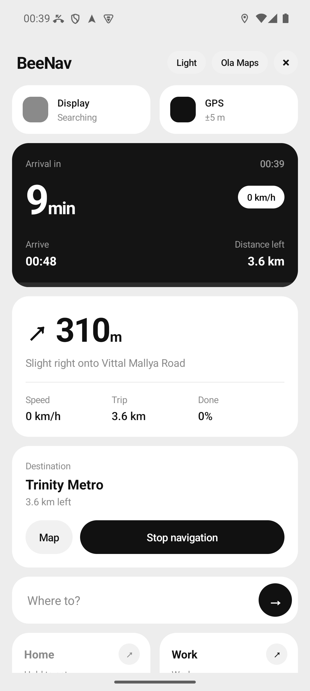

# BeeNav

Android companion app for the BeeNav handlebar display: a round 240×240 screen
(ESP32-S3 + GC9A01) that shows the next turn, distance and arrival time while you ride.
The phone does the routing and GPS and sends a small window of the route to the display over Bluetooth LE.

Firmware for the display lives in a separate repo (`beeline_nav`).



## Features

- Search a destination, or share a place into the app from Maps (`geo:` and maps links)
- Turn-by-turn on the display: arrow, distance to turn, street name of the next road, junction view with side roads
- Arrival time, distance left, speed, trip progress
- Home / Work favourites and recent destinations
- Off-route warning and "destination reached" screen on the display
- Clock and incoming-call name shown on the display
- Keeps navigating in the background (foreground service with a live notification), resumes the trip after the app is killed
- Light and dark theme

## Map services

Pick one under **Settings**:

| Service | Key needed | Notes |
|---|---|---|
| OpenStreetMap | no | OSRM routing + Nominatim search, free, no map pictures |
| Ola Maps | yes | routing, search, map pictures, side roads for the junction view |
| Google Maps | yes | Routes API, Places (New), Static Maps, Maps JavaScript API; needs a billing account |

A key can be pasted in the app under Settings, or put in `ola_key.txt` / `google_key.txt`
next to `build.sh` to compile it in as the default. Key files are gitignored; never commit them.

## Build

No Gradle. `build.sh` uses the Android SDK command-line tools directly.

Requirements:
- JDK 11 or newer (`javac`, `keytool`)
- Android SDK at `$ANDROID_HOME` (default `~/Android/Sdk`) with build-tools 36.1.0 and platform android-35
- `adb` for installing

```sh
./build.sh            # builds beelinenav.apk
./build.sh install    # builds, then installs on the phone connected over USB
```

The APK is signed with the debug keystore (`~/.android/debug.keystore`, created if missing).
Each build gets a stamp (`MMDD.HHMM`) shown under Settings → About.

## Permissions

Location (GPS while navigating), Bluetooth scan/connect (the display), notifications
(trip notification), phone state, call log and contacts (caller name on the display),
internet (routing and search).

## Project layout

```
src/dev/guts/beelinenav/
  MainActivity.java      main screen (card UI, built in code)
  SettingsActivity.java  map service, keys, theme, about
  CardActivity.java      shared card helpers and palette
  MapActivity.java       full-screen map (WebView + MapLibre / Google)
  NavService.java        foreground service: GPS, route progress, sends to the display
  NavRoute.java          route model, snapping, turn detection, BLE packets
  Ble.java               Bluetooth LE connection to the display
  Router.java            routing and search (OSRM/Nominatim, Ola, Google)
  Roads.java, Mvt.java   side roads from Ola vector tiles
  Links.java             parses shared map links
  Recents.java           recent destinations and favourites
  Theme.java             light/dark
assets/                  map pages and MapLibre
res/drawable/            launcher and notification icons
```

The BLE protocol (service `7b1e0001-…`) is documented in comments in `NavRoute.java`,
`NavService.java` and the firmware sketch; keep both sides in sync.
